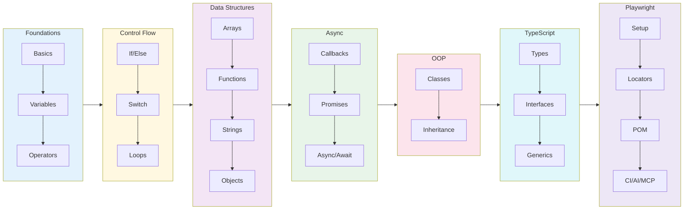
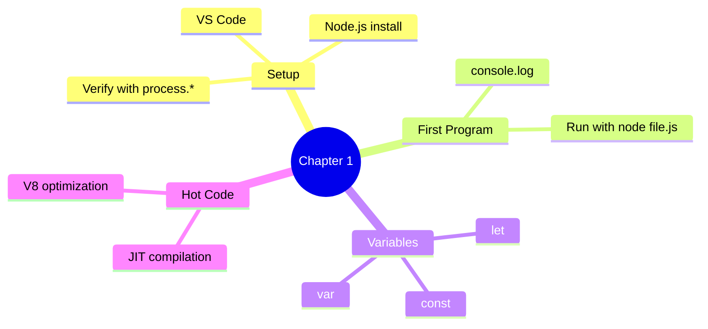
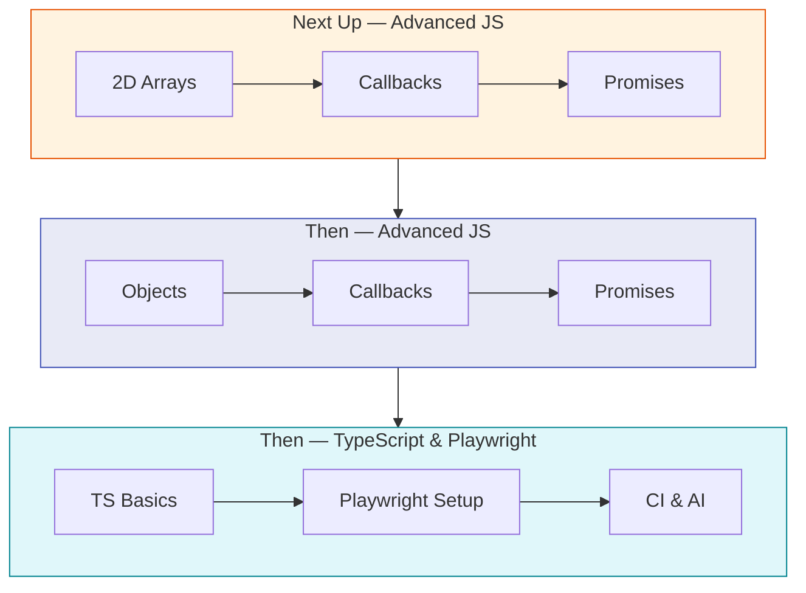
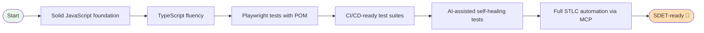
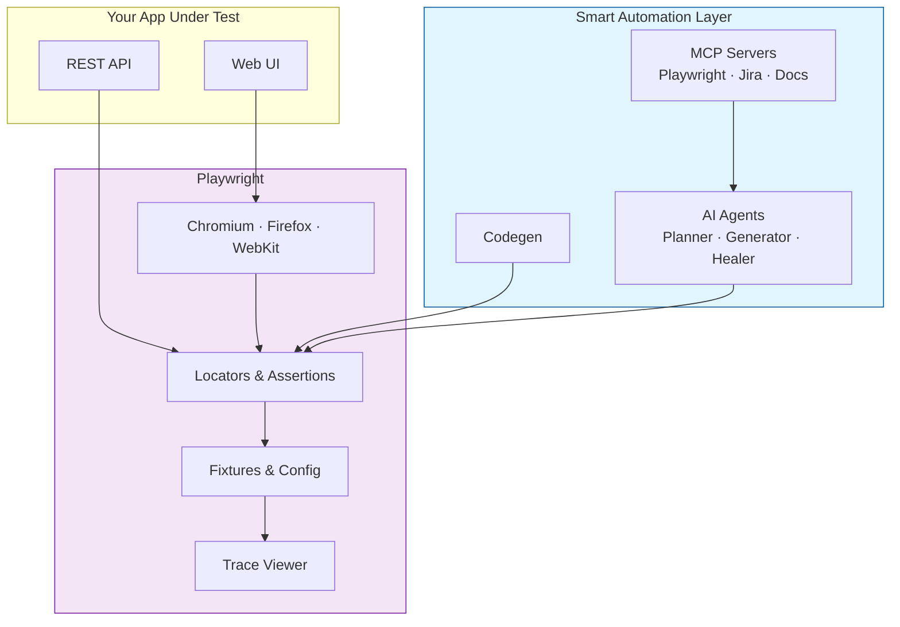

# Learn Playwright Batch 2x

[](https://playwright.dev) [](https://developer.mozilla.org/en-US/docs/Web/JavaScript) [](https://www.typescriptlang.org/) [](https://nodejs.org/) []()

**The official course repository for Batch 2x — JavaScript, TypeScript, and Playwright for SDETs**

*Zero to automation hero — JavaScript fundamentals → TypeScript → Playwright → AI Agents & MCP*

[Quick Start](#-quick-start) · [Curriculum](#-curriculum-roadmap) · [Weekly Plan](#-weekly-plan) · [What You'll Build](#-what-youll-build) · [Resources](#-resources)

---

## Welcome to Batch 2x

This repository is your **week-by-week course companion** for the LearnPlaywright Batch 2x cohort by [The Testing Academy](https://thetestingacademy.com). Code shown in lectures lands here so you can read it, run it, and practice on it.

> Content gets added **as we progress through the batch** — so check back after every class.
>
> **Last updated:** 8th Jun 2026 — Class code committed (2D Arrays: rows/columns, grid vs matrix, indexing, iteration with `for` / `for...of` / `forEach`, real test-matrix reporting, `map` + `reduce` on rows, filtering failed suite results, star pattern printing, plus `testData.csv` and new Objects interview notes)

### What you'll learn

- **JavaScript Fundamentals** — variables, control flow, arrays, functions, OOP, async
- **TypeScript** — types, interfaces, enums, generics, access modifiers, decorators
- **Playwright** — setup, locators, assertions, fixtures, POM, debugging, CI
- **Modern QA** — Playwright CLI, AI Agents, and MCP for full STLC automation

---

## 🗺️ Curriculum Roadmap

```mermaid
graph TB
    subgraph root["LearnPlaywrightBatch2x"]
        direction TB

        subgraph js["📘 JavaScript (Weeks 1–6)"]
            ch1["Ch 1: Basics ✅"]
            ch2["Ch 2: JS Concepts ✅"]
            ch3["Ch 3: Identifiers & Literals ✅"]
            ch4["Ch 4: Operators & Concepts ✅"]
            ch5["Ch 5: Literals ✅"]
            ch6["Ch 6: Operators ✅"]
            ch7["Ch 7: If / Else ✅"]
            ch8["Ch 8: Switch ✅"]
            ch9["Ch 9: User Input ✅"]
            ch10["Ch 10: Loops ✅"]
            ch11["Ch 11: Arrays ✅"]
            ch12["Ch 12: Functions ✅"]
            ch13s["Ch 13: Strings ✅"]
            ch14o["Ch 14: Objects ✅"]
            ch15a["Ch 15: 2D Arrays ✅"]
        end

        subgraph adv["⚙️ Advanced JS (Weeks 7–8)"]
            adv1["Ch 11: 2D Arrays"]
            adv2["Ch 12: Callbacks"]
            adv3["Ch 13: Promises"]
            adv4["Ch 14: Async / Await"]
            adv5["Ch 15: OOP - Classes"]
            adv6["Ch 16: Inheritance"]
        end

        subgraph ts["🟦 TypeScript (Week 9)"]
            ch18["Ch 18: TS Fundamentals"]
            ch19["Ch 19: Interfaces"]
            ch20["Ch 20: Enums"]
            ch21["Ch 21: Generics"]
            ch22["Ch 22: Access Modifiers & Decorators"]
        end

        subgraph pw["🎭 Playwright (Weeks 10–12)"]
            ch23["Ch 23: PW Fundamentals"]
            cli["Lecture: Playwright CLI"]
            ai["Lecture: AI Agents"]
            mcp["Lecture: MCP Protocol"]
        end

        subgraph extras["🎯 Bonus"]
            tasks["Interview Coding Questions"]
            tests["Real-world Test Projects"]
        end
    end

    js --> adv --> ts --> pw --> extras

    style js fill:#e1f5fe,stroke:#01579b
    style adv fill:#fff3e0,stroke:#e65100
    style ts fill:#e0f7fa,stroke:#00838f
    style pw fill:#f3e5f5,stroke:#7b1fa2
    style extras fill:#e8f5e9,stroke:#2e7d32
```



---

## 📚 Current Folder Structure

```
LearnPlaywrightBatch2x/
├── Chapter_01_Basics/                  ✅ Hello World, env setup, hot code
│   ├── 01_Basics.js                    # First console.log program
│   ├── 02_JS.js                        # Variables & a simple loop
│   ├── 03_JS_Verify_Setup.js           # Verify Node.js/OS/arch
│   └── 04_HotCode.js                   # JIT & "hot" code paths
│
├── Chapter02_Javascript_Concepts/      ✅ var / let / const & hoisting
│   └── 05_JS_Basics.js
│
├── Chapter03_Identifier_Literals/      ✅ Identifiers, literals, equality
│   ├── 06_Identifier_Rules.js
│   ├── 07_Identifier_Part2.js
│   ├── 08_Comments.js
│   ├── js_identifier_rules.js
│   ├── VS_Code_keyboard_shortcut_windows.md
│   └── VS_Code_keyboard_shortcut_mac.md
│
│
├── Chapter_04_Javascript_Concepts/      ✅ var, let, const, scope, hoisting
│   ├── 09_var_let_const.js               # var/let/const basics & loop leaks
│   ├── 10_functions.js                   # Defining & calling functions
│   ├── 11_var_explained.js               # var: global vs function scope
│   ├── 12_let_peope_love.js              # let: block scope, re-declaration rules
│   ├── 13_const_explained.js             # const: immutability & block scope
│   ├── 14_var_functionscope.js           # var function-scoping in detail
│   ├── 15_let_scope.js                   # let block-scoping in detail
│   ├── 16_Hoisting.js                    # var hoisting with undefined
│   ├── 17_hoisting_fn.js                 # Function-scoped hoisting
│   ├── 18_let_hoisting.js                # let hoisting & Temporal Dead Zone (TDZ)
│   ├── 19_let_hoisting_block.js          # block-scoped let hoisting behavior
│   ├── 20_let_const.js                   # const TDZ demo
│   ├── 21_Jr_QA.js                       # common junior QA interview question
│
├── chapter_05_Literal/                   ✅ Literals — numbers, strings, template literals, null/undefined
│   ├── 22_Literal.js                     # typeof all literal types
│   ├── 23_null_undefined.js              # null vs undefined deep dive
│   ├── 24_null.js                        # null usage examples
│   ├── 25_Literal_All.js                 # integer & hex/octal literals
│   ├── 26_Literal_Number_all.js          # all number types, BigInt, Infinity, NaN
│   ├── 27_String.js                      # single vs double quotes
│   ├── 28_Template_Literal.js            # backticks & variable interpolation
│   └── 29_Backtick_single_double.js      # quote comparison table
│
├── chapter_06_Operator/                  ✅ Operators — arithmetic, comparison, logical, ternary
│   ├── 30_Operator.js                    # Assignment operators
│   ├── 31_Arithmetic_OP.js               # +, -, *, / basics
│   ├── 32_Modulus_OP.js                  # % remainder & odd/even check
│   ├── 33_Expo_OP.js                     # ** exponentiation
│   ├── 34_IQ.js                          # Compound assignment operators
│   ├── 35_Comparsion_OP.js               # >, <, >=, <=, ==, ===
│   ├── 36_Comparsion_Strict_loose.js     # Loose vs strict equality
│   ├── 37_IQ_Loose_Strict.js             # Tricky loose equality gotchas
│   ├── 38_Confusing_Comparsion.js        # Deep dive: == vs === edge cases
│   ├── 39_Logical_Op.js                  # &&, ||, ! logical gates
│   └── 40_String_Con_Op.js               # String concatenation with +=
│
├── chapter_07_If_else/                    ✅ If / Else — conditional statements
│   ├── 48_IF_ESLE.js                     # Basic if/else syntax
│   ├── 49_If_elseif_else.js              # if/else if/else ladder
│   ├── 50_REAL_IF_ELSE.js                # Real-world examples
│   ├── 51_API_IF_ELSE.js                 # API response handling
│   ├── 52_IQ_IF_ELSE.js                  # Interview questions
│   ├── 53_IF_ELSE_real.js                # Practical if/else scenarios
│   ├── 54_IQ.js                          # IQ puzzles with if/else
│   ├── 55_IE.js                          # if/else expressions
│   ├── 56_IQ_EVEN_ODD.js                 # Even/odd checker
│   ├── 57_Grade_Calc.js                  # Grade calculator
│   ├── 58_LEAP_YEAR.js                   # Leap year checker
│   ├── 20May_Task01_http_statusCode.js   # Task: HTTP status categorizer
│   ├── 20May_Task02_passfail_verdict.js  # Task: Pass/fail verdict
│   ├── 20May_Task03_Bug_severity.js      # Task: Bug severity classifier
│   ├── 20May_Task04_BuildHealth_reporter.js  # Task: Build health reporter
│   └── 20May_Task05_Login_Logout.js      # Task: Login/Logout flow
│
├── chapter_08_Switch_Statement/           ✅ Switch — case-based control flow
│   ├── 59_Switch.js                      # Basic switch statement
│   ├── 60_No_Break.js                    # Fall-through behavior
│   ├── 61_Default.js                     # Default case handling
│   ├── 62_REAL_TIME_EXAMPLE.js           # Real-world switch examples
│   ├── 63_Switch_Group.js                # Grouped case statements
│   ├── 64_IQ.js                          # Interview questions
│   ├── 65_IQ2.js                         # More IQ puzzles
│   ├── 66_IQ3.js                         # Switch challenge problems
│   └── 67_IQ4.js                         # Advanced switch patterns
│
├── chapter_09_UserInput/                  ✅ User Input — prompt, readline
│   ├── 68_User_Input.js                   # Browser prompt() input
│   ├── 69_Node_readline.js               # Node.js readline module
│   └── 70_prompt_sync.js                 # Synchronous prompt with prompt-sync
│
├── chapter_10_Loops/                      ✅ Loops — for, while, do...while, for...of, for...in
│   ├── 71_For_loop.js                    # For loop basics
│   ├── 72_For_loop.js                    # For loop variations
│   ├── 73_For_Loop2.js                   # More for loop examples
│   ├── 74_IQ.js                          # Loop interview questions
│   ├── 75_For_OF_IN_EACH.js              # for...of vs for...in
│   ├── 76_While.js                       # While loop basics
│   ├── 77_Do_While.js                    # Do...while loop
│   ├── 78_Do_While.js                    # Do...while variations
│   ├── 79_IQ.js                          # Loop IQ puzzles
│   ├── 80_IQ.js                          # More loop challenges
│   ├── 81_IQ.js                          # Advanced loop problems
│   ├── 82_IQ.js                          # Loop edge cases
│   ├── 22May_Task01_Triangles.js         # Task: Triangle patterns
│   └── 22May_Task02_Fizz_Buzz.js        # Task: FizzBuzz problem
│
├── chapter_11_Arrays/                    ✅ Arrays — creation, access, add/remove, search, iterate, transform
│   ├── 83_Arrays.js                      # Array basics & creation
│   ├── 84_Arrays.js                      # Array constructor methods
│   ├── 85_Access_Array.js                # Accessing & modifying elements
│   ├── 86_Arrays_Adding_Remove.js        # push, pop, unshift, shift
│   ├── 87_Adding_Remove2.js              # splice for add/remove/replace
│   ├── 88_REAL_Example.js                # Real-world array operations
│   ├── 89_Searching.js                   # indexOf, lastIndexOf, includes, find
│   ├── 90_Iterate.js                     # Iterating arrays (for, for...of, forEach, for...in)
│   ├── 91_Transform_Array.js             # map, filter, reduce, flat
│   ├── 92_Arrays.js                      # Array sorting (lexicographic & numeric)
│   ├── 93_Array_Slicing.js               # slice vs splice — non-mutating vs mutating
│   ├── 94_Concat_array.js                # concat, spread (...), join
│   ├── 95_Array_Checking.js              # Array.isArray, every, some
│
├── chapter_12_Funtions/                  ✅ Functions — declaration, expression, arrow
│   ├── 96_Functions.js                   # Function definition & calling basics
│   ├── 97_Type1_Fn_Basic_Functions.js    # Type 1: no param, no return
│   ├── 98_Type2_Fn_With_Param_No_Return.js # Type 2: with param, no return
│   ├── 99_Type3_Fn_without_Param_Return_Type.js # Type 3: no param, with return
│   ├── 100_Type4_Fn_With_Param_With_Return.js # Type 4: with param, with return
│   ├── 101_Template_literal.js           # Template literals inside functions
│   ├── 102_Fn_Expression.js              # Function expressions
│   ├── 103_Arrow_Fn.js                   # Arrow functions (ES6)
│   ├── 104_Arrow_Fn_REAL.js              # Arrow fn: normal vs expression vs arrow
│   ├── 105_IIFE.js                       # Immediately Invoked Function Expressions
│   ├── 106_Default_Param_Fn.js           # Default parameters in functions
│   ├── 107_IQ.js                         # Function interview questions
│   ├── 108_Rest_Param_Fn.js              # Rest parameters (...args)
│   ├── 109_IQ.js                         # Return values & hoisting IQ
│   ├── 110_Spead_IQ.js                   # Spread operator with functions
│   ├── 111_Scope._Fn.js                  # Global vs local scope in functions
│   ├── 112_IQ.js                         # Nested & block scope IQ
│   ├── 113_Closure.js                    # Closures — inner functions returned
│   ├── 114_Closure.js                    # Closure counter example
│   ├── 115_API_REAL_Closure.js           # Real-world closure: retry tracker
│   ├── 116_Higher_Order_Fn.js            # Higher-order functions
│   └── 117_Pure_Fn.js                    # Pure functions vs side effects
│
├── chapter_13_Strings/                   ✅ Strings — creation, properties, search, slice, transform, split/join
│   ├── 118_Strings.js                    # String basics, template literals, multi-line, String()
│   ├── 119_String_Properties.js          # length, index access, at(), charAt(), charCodeAt()
│   ├── 120_Search_Check_Str.js           # includes, startsWith, endsWith, indexOf, lastIndexOf, search
│   ├── 121_Substring.js                  # slice vs substring, negative indexing
│   ├── 122_Transform_Str.js              # case, trim, replace/replaceAll, split & join
│   ├── 123_SC.js                         # toString, Number, parseInt, parseFloat
│   └── javascript_stringcheatsheet.md    # Quick reference: all common String methods
│
├── chapter_14_Objects/                   ✅ Objects — creation, keys/values, reference vs primitive, destructuring, spread, get/set
│   ├── 124_Objects.js                    # What an object is — key-value pairs in heap memory
│   ├── 125_Objects2.js                   # Key/value basics + copy-by-reference demo
│   ├── 126_Objects_Creation.js           # Two identical objects are not === equal
│   ├── 127_Objects_REAL.js               # Real-world config object, add & delete properties
│   ├── 128_Primitive_Ref.js              # Primitive copy vs object reference copy
│   ├── 129_Ob_Examples.js                # JSON-style vs JS object literals
│   ├── 130_IQ.js                         # Dot vs bracket access, dynamic keys, property descriptor
│   ├── 131_Object_Fn.js                  # Objects holding methods
│   ├── 132_Obj_Decon.js                  # Destructuring, renaming, defaults, nested objects
│   ├── 133_Spead.js                      # Spread copy & mutating object properties
│   ├── 134_Objects_GET_SET_Methods.js    # get / set accessors with this
│   ├── 135_IQ                            # Object.keys / values / entries + for...in iteration
│   ├── 136_Obj_REAL.js                   # Environment, API response & config objects
│   ├── 137_Let_const_obj.js              # let vs const with objects — mutate yes, reassign no
│   └── Interview.md                      # Interview notes: why const for object references
│
├── chapter_15_2D_Array/                  ✅ 2D Arrays — rows/columns, grids, iteration, patterns
│   ├── 138_2D_Array.js                   # 1D vs 2D arrays, nested loop traversal
│   ├── 139_2d.js                         # Rows vs columns, 2D array vs grid, indexing
│   ├── 140_REAL.js                       # Real test matrix — for / for...of / forEach
│   ├── 141_2d_Array_Fn.js                # map + reduce row sums, filtering failed tests
│   ├── 142_IQ_Right_Pattern_Py.js        # Star pattern (right triangle) with nested loops
│   └── testData.csv                      # Sample test data — login cases & expected result
│
├── Tasks_LiveClass_Code/                 ✅ Live-class tasks & assignments
│   ├── 11May_Task01_diff_let_var_const.md    # Task: var vs let vs const
│   ├── 11May_Task02_hoisting.md              # Task: Hoisting
│   ├── 11May_Task03.md                       # Task: Practice questions
│   ├── 11May_Task04.md                       # Task: Practice questions
│   ├── 11May_Task05.js                       # Task: Coding exercise
│   ├── 03Jun_Task06_PalindromReverseString.js # Task: Reverse string & palindrome check
│   └── 03Jun_Task07_Anagram.js               # Task: Check if two strings are anagrams
│
└── README.md                           👋 You are here
```

> **Legend:** ✅ Done · 🚧 Coming soon

---

## 🚀 Quick Start

### Prerequisites

| Tool | Version | Purpose |
|------|---------|---------|
| **Node.js** | 18+ (LTS recommended) | Runs all `.js` files |
| **npm** | Bundled with Node | Package manager |
| **VS Code** | Latest | Recommended editor |
| **Git** | Latest | Clone the repo |

### Setup

```bash
# 1. Clone the repository
git clone https://github.com/HBSahoo/LearnPlaywrightBatch2x.git
cd LearnPlaywrightBatch2x

# 2. Verify your setup
node Chapter_01_Basics/03_JS_Verify_Setup.js

# 3. Run your first JS program
node Chapter_01_Basics/01_Basics.js
```

### Verify it works

```bash
$ node Chapter_01_Basics/01_Basics.js
Hello The Testing Academy
```

If you see that line, you're all set! 🎉

---

## 📅 Weekly Plan


| Week | Topic | Chapters | Outcome |
|------|-------|----------|---------|
| 1 | JS Basics & Setup | Ch 1 | Run Node, write first JS |
| 2 | Variables & Hoisting | Ch 2 | Master `var`/`let`/`const` |
| 3 | Identifiers, Literals, Operators | Ch 3–4 | Read/write any expression |
| 4 | Control Flow | Ch 5–7 | If/else, switch, loops |
| 5 | Arrays & Functions | Ch 11–12 | Manipulate data confidently |
| 6 | Strings & Objects | Ch 10, 13 | Use JS data structures |
| 6 | Strings | Ch 13 ✅ | Master String methods & manipulation |
| 6 | Objects | Ch 14 ✅ | Build & manipulate JS objects |
| 6 | 2D Arrays | Ch 15 ✅ | Traverse rows & columns, build grids |
| 7 | Async (Callbacks → Promises) | Ch 12–14 | Handle async work |
| 8 | Async/Await + OOP | Ch 15–17 | Modern async, classes |
| 9 | TypeScript | Ch 18–22 | Type-safe automation code |
| 10 | Playwright Fundamentals | Ch 23 | First passing test |
| 11 | Playwright CLI Mastery | CLI Lecture | Codegen, debug, trace |
| 12 | AI Agents + MCP | AI/MCP Lectures | Self-healing, full STLC |

---

## 🧭 Learning Flow



---

## 📖 What's in Chapter 1 (Available Now)

### Files

| File | Topic | What you'll learn |
|------|-------|-------------------|
| `01_Basics.js` | Hello World | First `console.log`, declaring a variable |
| `02_JS.js` | Variables & Loops | Re-declaring with `let`, calling functions inside loops |
| `03_JS_Verify_Setup.js` | Environment Check | `process.platform`, `process.arch`, `process.version` |
| `04_HotCode.js` | Hot Code Paths | How V8 optimizes frequently-called functions |

### Key Concepts



### Run them

```bash
node Chapter_01_Basics/01_Basics.js          # → "Hello The Testing Academy"
node Chapter_01_Basics/02_JS.js              # → counts to 100000 calling print()
node Chapter_01_Basics/03_JS_Verify_Setup.js # → prints platform / arch / node version
node Chapter_01_Basics/04_HotCode.js         # → triggers V8 hot-path optimization
```

---

## 📖 What's in Chapter 2 (Available Now)

### Files

| File | Topic | What you'll learn |
|------|-------|-------------------|
| `05_JS_Basics.js` | Variables & Hoisting | `var` vs `let` vs `const`, hoisting behavior |

### Run it

```bash
node Chapter02_Javascript_Concepts/05_JS_Basics.js
```

---

## 📖 What's in Chapter 3 (Available Now)

### Files

| File | Topic | What you'll learn |
|------|-------|-------------------|
| `06_Identifier_Rules.js` | Identifier Rules | Valid names for variables & functions |
| `07_Identifier_Part2.js` | More Identifiers | Reserved words, naming conventions |
| `08_Comments.js` | Comments | Single-line, multi-line, JSDoc style |
| `js_identifier_rules.js` | Identifier Extras | Additional identifier examples |
| `VS_Code_keyboard_shortcut_windows.md` | VS Code Shortcuts | Windows keyboard cheat sheet |
| `VS_Code_keyboard_shortcut_mac.md` | VS Code Shortcuts | Mac keyboard cheat sheet |

### Run them

```bash
node Chapter03_Identifier_Literals/06_Identifier_Rules.js
node Chapter03_Identifier_Literals/07_Identifier_Part2.js
node Chapter03_Identifier_Literals/08_Comments.js
node Chapter03_Identifier_Literals/js_identifier_rules.js
```

---

## 📖 What's in Chapter 4 (Available Now)

### Files

| File | Topic | What you'll learn |
|------|-------|-------------------|
| `09_var_let_const.js` | var / let / const | Differences, redeclaration, reassignment, loop leaks |
| `10_functions.js` | Functions | Defining and calling functions in JavaScript |
| `11_var_explained.js` | var Scope | Global scope vs function scope, var behavior |
| `12_let_peope_love.js` | let Scope | Block scope, re-declaration rules, loyalty of let |
| `13_const_explained.js` | const | Immutability, block scope, when to use const |
| `14_var_functionscope.js` | var Deep Dive | Function-scoped var in nested blocks |
| `15_let_scope.js` | let Deep Dive | Block-scoped let in nested blocks |
| `16_Hoisting.js` | Hoisting Basics | How var declarations are hoisted with undefined |
| `17_hoisting_fn.js` | Function Hoisting | Function-scoped hoisting behavior |
| `18_let_hoisting.js` | let Hoisting | Temporal Dead Zone (TDZ) with let |
| `19_let_hoisting_block.js` | Block Hoisting | Block-scoped let hoisting behavior |
| `20_let_const.js` | const TDZ | const temporal dead zone demo |
| `21_Jr_QA.js` | Jr QA Question | Common junior QA interview question on hoisting |

### Run them

```bash
node Chapter_04_Javascript_Concepts/09_var_let_const.js
node Chapter_04_Javascript_Concepts/10_functions.js
node Chapter_04_Javascript_Concepts/11_var_explained.js
node Chapter_04_Javascript_Concepts/12_let_peope_love.js
node Chapter_04_Javascript_Concepts/13_const_explained.js
node Chapter_04_Javascript_Concepts/14_var_functionscope.js
node Chapter_04_Javascript_Concepts/15_let_scope.js
node Chapter_04_Javascript_Concepts/16_Hoisting.js
node Chapter_04_Javascript_Concepts/17_hoisting_fn.js
node Chapter_04_Javascript_Concepts/18_let_hoisting.js
node Chapter_04_Javascript_Concepts/19_let_hoisting_block.js
node Chapter_04_Javascript_Concepts/20_let_const.js
node Chapter_04_Javascript_Concepts/21_Jr_QA.js
```

---

## 📖 What's in Chapter 5 (Available Now)

### Files

| File | Topic | What you'll learn |
|------|-------|-------------------|
| `22_Literal.js` | Literal Types | typeof string, number, boolean, null, undefined |
| `23_null_undefined.js` | null vs undefined | Deep dive, comparisons, when to use what |
| `24_null.js` | null Examples | Practical null usage examples |
| `25_Literal_All.js` | Integer Literals | Decimal, hex, octal, exponential notation |
| `26_Literal_Number_all.js` | All Number Types | Binary, BigInt, Infinity, NaN, Number properties |
| `27_String.js` | Strings | Single quotes vs double quotes |
| `28_Template_Literal.js` | Template Literals | Backticks, variable interpolation, real Playwright examples |
| `29_Backtick_single_double.js` | Quote Comparison | Feature table: '' / "" vs `` |

### Run them

```bash
node chapter_05_Literal/22_Literal.js
node chapter_05_Literal/23_null_undefined.js
node chapter_05_Literal/24_null.js
node chapter_05_Literal/25_Literal_All.js
node chapter_05_Literal/26_Literal_Number_all.js
node chapter_05_Literal/27_String.js
node chapter_05_Literal/28_Template_Literal.js
node chapter_05_Literal/29_Backtick_single_double.js
```

---

## 📖 What's in Chapter 6 (Available Now)

### Files

| File | Topic | What you'll learn |
|------|-------|-------------------|
| `30_Operator.js` | Assignment Operators | `=` to assign values to variables |
| `31_Arithmetic_OP.js` | Arithmetic Operators | `+`, `-`, `*`, `/` with variables |
| `32_Modulus_OP.js` | Modulus Operator | `%` remainder, odd/even check |
| `33_Expo_OP.js` | Exponentiation | `**` operator for powers |
| `34_IQ.js` | Compound Operators | `+=`, `-=`, `*=`, `/=`, `%=` shorthand |
| `35_Comparsion_OP.js` | Comparison Operators | `>`, `<`, `>=`, `<=`, `==`, `===` basics |
| `36_Comparsion_Strict_loose.js` | Loose vs Strict | `==` coercion surprises vs `===` safety |
| `37_IQ_Loose_Strict.js` | Tricky Equality | Transitivity breaks, `null`, `undefined` gotchas |
| `38_Confusing_Comparsion.js` | Edge Case Deep Dive | `[]`, `{}`, `NaN`, `null >= 0` and more |
| `39_Logical_Op.js` | Logical Operators | `&&` (AND), `||` (OR), `!` (NOT) |
| `40_String_Con_Op.js` | String Concatenation | Using `+=` to build strings |
| `41_Ternary_Op.js` | Ternary Operator | `? :` conditional expressions |
| `42_Type_Op.js` | Type Operators | `typeof` for all literal types |
| `43_Incre_Decre_Op.js` | Pre Increment / Decrement | `++a`, `--a` behavior |
| `44_Null_Op.js` | Nullish Coalescing | `??` operator and `null` comparisons |
| `45_Post_Incre_Decr op.js` | Post Increment / Decrement | `a++`, `a--` behavior |
| `46_IQ_INCREMENT_D.js` | Interview Questions | Tricky increment / decrement outputs |
| `47_Advance_ID_.js` | Advanced Increment / Decrement | Complex prefix / postfix expressions |
| `18May_Task01_Ternary_Op.js` | Task: Ternary (2 numbers) | Find maximum of two numbers |
| `18May_Task02_Ternary_Op.js` | Task: Ternary (3 numbers) | Find maximum of three numbers |
| `18May_Task03_Incre_Decre_Op.js` | Task: Increment / Decrement | Evaluate complex `++` / `--` expressions |

### Run them

```bash
node chapter_06_Operator/30_Operator.js
node chapter_06_Operator/31_Arithmetic_OP.js
node chapter_06_Operator/32_Modulus_OP.js
node chapter_06_Operator/33_Expo_OP.js
node chapter_06_Operator/34_IQ.js
node chapter_06_Operator/35_Comparsion_OP.js
node chapter_06_Operator/36_Comparsion_Strict_loose.js
node chapter_06_Operator/37_IQ_Loose_Strict.js
node chapter_06_Operator/38_Confusing_Comparsion.js
node chapter_06_Operator/39_Logical_Op.js
node chapter_06_Operator/40_String_Con_Op.js
node chapter_06_Operator/41_Ternary_Op.js
node chapter_06_Operator/42_Type_Op.js
node chapter_06_Operator/43_Incre_Decre_Op.js
node chapter_06_Operator/44_Null_Op.js
node "chapter_06_Operator/45_Post_Incre_Decr op.js"
node chapter_06_Operator/46_IQ_INCREMENT_D.js
node chapter_06_Operator/47_Advance_ID_.js
node chapter_06_Operator/18May_Task01_Ternary_Op.js
node chapter_06_Operator/18May_Task02_Ternary_Op.js
node chapter_06_Operator/18May_Task03_Incre_Decre_Op.js
```

---

## 📖 What's in Chapter 7 (Available Now)

### Files

| File | Topic | What you'll learn |
|------|-------|-------------------|
| `48_IF_ESLE.js` | If / Else Basics | Basic conditional statement syntax |
| `49_If_elseif_else.js` | If / Else If | Multiple condition ladder |
| `50_REAL_IF_ELSE.js` | Real Examples | Practical if/else use cases |
| `51_API_IF_ELSE.js` | API Handling | Using if/else with API responses |
| `52_IQ_IF_ELSE.js` | IQ Questions | Interview-style if/else problems |
| `53_IF_ELSE_real.js` | Practical Scenarios | Real-world conditional logic |
| `54_IQ.js` | IQ Puzzles | Brain teasers with conditionals |
| `55_IE.js` | Expressions | if/else expressions |
| `56_IQ_EVEN_ODD.js` | Even/Odd | Number parity checker |
| `57_Grade_Calc.js` | Grade Calculator | Calculate grades from scores |
| `58_LEAP_YEAR.js` | Leap Year | Check if a year is a leap year |
| `20May_Task01_http_statusCode.js` | Task: HTTP Status | Categorize HTTP status codes |
| `20May_Task02_passfail_verdict.js` | Task: Pass/Fail | Generate test verdicts |
| `20May_Task03_Bug_severity.js` | Task: Bug Severity | Classify bug severity levels |
| `20May_Task04_BuildHealth_reporter.js` | Task: Build Health | Report build health status |
| `20May_Task05_Login_Logout.js` | Task: Login Flow | Simulate login/logout logic |

### Run them

```bash
node chapter_07_If_else/48_IF_ESLE.js
node chapter_07_If_else/49_If_elseif_else.js
node chapter_07_If_else/50_REAL_IF_ELSE.js
node chapter_07_If_else/51_API_IF_ELSE.js
node chapter_07_If_else/52_IQ_IF_ELSE.js
node chapter_07_If_else/53_IF_ELSE_real.js
node chapter_07_If_else/54_IQ.js
node chapter_07_If_else/55_IE.js
node chapter_07_If_else/56_IQ_EVEN_ODD.js
node chapter_07_If_else/57_Grade_Calc.js
node chapter_07_If_else/58_LEAP_YEAR.js
node chapter_07_If_else/20May_Task01_http_statusCode.js
node chapter_07_If_else/20May_Task02_passfail_verdict.js
node chapter_07_If_else/20May_Task03_Bug_severity.js
node chapter_07_If_else/20May_Task04_BuildHealth_reporter.js
node chapter_07_If_else/20May_Task05_Login_Logout.js
```

---

## 📖 What's in Chapter 8 (Available Now)

### Files

| File | Topic | What you'll learn |
|------|-------|-------------------|
| `59_Switch.js` | Switch Basics | Basic switch statement syntax |
| `60_No_Break.js` | Fall-through | Behavior without break keyword |
| `61_Default.js` | Default Case | Handling unmatched cases |
| `62_REAL_TIME_EXAMPLE.js` | Real Examples | Practical switch use cases |
| `63_Switch_Group.js` | Grouped Cases | Multiple cases with same output |
| `64_IQ.js` | IQ Questions | Interview-style switch problems |
| `65_IQ2.js` | More IQ | Additional switch puzzles |
| `66_IQ3.js` | Challenges | Switch statement challenges |
| `67_IQ4.js` | Advanced | Complex switch patterns |

### Run them

```bash
node chapter_08_Switch_Statement/59_Switch.js
node chapter_08_Switch_Statement/60_No_Break.js
node chapter_08_Switch_Statement/61_Default.js
node chapter_08_Switch_Statement/62_REAL_TIME_EXAMPLE.js
node chapter_08_Switch_Statement/63_Switch_Group.js
node chapter_08_Switch_Statement/64_IQ.js
node chapter_08_Switch_Statement/65_IQ2.js
node chapter_08_Switch_Statement/66_IQ3.js
node chapter_08_Switch_Statement/67_IQ4.js
```

---

## 📖 What's in Chapter 9 (Available Now)

### Files

| File | Topic | What you'll learn |
|------|-------|-------------------|
| `68_User_Input.js` | Browser Input | Using `prompt()` in browser environments |
| `69_Node_readline.js` | Node Readline | Using Node.js readline module |
| `70_prompt_sync.js` | Synchronous Prompt | Using prompt-sync package |

### Run them

```bash
node chapter_09_UserInput/68_User_Input.js
node chapter_09_UserInput/69_Node_readline.js
node chapter_09_UserInput/70_prompt_sync.js
```

---

## 📖 What's in Chapter 10 (Available Now)

### Files

| File | Topic | What you'll learn |
|------|-------|-------------------|
| `71_For_loop.js` | For Loop Basics | Basic `for` loop syntax and usage |
| `72_For_loop.js` | For Loop Variations | Different ways to write for loops |
| `73_For_Loop2.js` | More For Loops | Additional for loop examples |
| `74_IQ.js` | IQ Questions | Interview-style loop problems |
| `75_For_OF_IN_EACH.js` | for...of vs for...in | Iterating arrays and objects |
| `76_While.js` | While Loop | Basic `while` loop syntax |
| `77_Do_While.js` | Do...While Loop | `do...while` loop basics |
| `78_Do_While.js` | Do...While Variations | More do...while examples |
| `79_IQ.js` | Loop IQ Puzzles | Tricky loop problems |
| `80_IQ.js` | More Loop Challenges | Additional loop puzzles |
| `81_IQ.js` | Advanced Loop Problems | Complex loop scenarios |
| `82_IQ.js` | Loop Edge Cases | Edge cases with loops |
| `22May_Task01_Triangles.js` | Task: Triangles | Print triangle patterns with loops |
| `22May_Task02_Fizz_Buzz.js` | Task: FizzBuzz | Classic FizzBuzz problem |

### Run them

```bash
node chapter_10_Loops/71_For_loop.js
node chapter_10_Loops/72_For_loop.js
node chapter_10_Loops/73_For_Loop2.js
node chapter_10_Loops/74_IQ.js
node chapter_10_Loops/75_For_OF_IN_EACH.js
node chapter_10_Loops/76_While.js
node chapter_10_Loops/77_Do_While.js
node chapter_10_Loops/78_Do_While.js
node chapter_10_Loops/79_IQ.js
node chapter_10_Loops/80_IQ.js
node chapter_10_Loops/81_IQ.js
node chapter_10_Loops/82_IQ.js
node chapter_10_Loops/22May_Task01_Triangles.js
node chapter_10_Loops/22May_Task02_Fizz_Buzz.js
```

---

## 📖 What's in Chapter 11 (Available Now)

### Files

| File | Topic | What you'll learn |
|------|-------|-------------------|
| `83_Arrays.js` | Array Basics | Creating arrays, empty arrays, mixed types |
| `84_Arrays.js` | Array Creation | Array literal, constructor, `Array.of()`, `Array.from()` |
| `85_Access_Array.js` | Access & Modify | Index access, `at()`, negative indexing, modifying elements |
| `86_Arrays_Adding_Remove.js` | Add/Remove Basics | `push()`, `pop()`, `unshift()`, `shift()` |
| `87_Adding_Remove2.js` | Splice | `splice()` for add, remove, and replace operations |
| `88_REAL_Example.js` | Real Example | Practical array operations with browser lists |
| `89_Searching.js` | Searching | `indexOf()`, `lastIndexOf()`, `includes()`, `find()`, `findIndex()`, `findLast()`, `findLastIndex()` |
| `90_Iterate.js` | Iteration | `for`, `for...of`, `forEach()`, `for...in`, `entries()` |
| `91_Transform_Array.js` | Transform | `map()`, `filter()`, `reduce()`, `flat()` |
| `92_Arrays.js` | Sorting | `sort()`, lexicographic vs numeric sorting, ascending/descending |
| `93_Array_Slicing.js` | Slice vs Splice | `slice()` (non-mutating) vs `splice()` (mutating) |
| `94_Concat_array.js` | Combine & Join | `concat()`, spread `...`, `join()` |
| `95_Array_Checking.js` | Checking | `Array.isArray()`, `every()`, `some()` |

### Run them

```bash
node chapter_11_Arrays/83_Arrays.js
node chapter_11_Arrays/84_Arrays.js
node chapter_11_Arrays/85_Access_Array.js
node chapter_11_Arrays/86_Arrays_Adding_Remove.js
node chapter_11_Arrays/87_Adding_Remove2.js
node chapter_11_Arrays/88_REAL_Example.js
node chapter_11_Arrays/89_Searching.js
node chapter_11_Arrays/90_Iterate.js
node chapter_11_Arrays/91_Transform_Array.js
node chapter_11_Arrays/92_Arrays.js
node chapter_11_Arrays/93_Array_Slicing.js
node chapter_11_Arrays/94_Concat_array.js
node chapter_11_Arrays/95_Array_Checking.js
```

---

## 📖 What's in Chapter 12 (Available Now)

### Files

| File | Topic | What you'll learn |
|------|-------|-------------------|
| `96_Functions.js` | Function Basics | Defining and calling a function |
| `97_Type1_Fn_Basic_Functions.js` | Type 1 | No parameter, no return |
| `98_Type2_Fn_With_Param_No_Return.js` | Type 2 | With parameter, no return |
| `99_Type3_Fn_without_Param_Return_Type.js` | Type 3 | No parameter, with return |
| `100_Type4_Fn_With_Param_With_Return.js` | Type 4 | With parameter, with return |
| `101_Template_literal.js` | Template Literals | Using backticks & `${}` inside functions |
| `102_Fn_Expression.js` | Function Expression | Assigning functions to variables |
| `103_Arrow_Fn.js` | Arrow Functions | ES6 arrow `=>` syntax, implicit return |
| `104_Arrow_Fn_REAL.js` | Arrow in Practice | Same logic as normal / expression / arrow fn |
| `105_IIFE.js` | IIFE | Immediately Invoked Function Expressions |
| `106_Default_Param_Fn.js` | Default Parameters | Default values for function params |
| `107_IQ.js` | Return Basics | Functions returning formatted strings |
| `108_Rest_Param_Fn.js` | Rest Parameters | `...results` gathering args into an array |
| `109_IQ.js` | Return & Hoisting | Return vs no-return, function hoisting gotchas |
| `110_Spead_IQ.js` | Spread in Functions | Spreading arrays into function arguments |
| `111_Scope._Fn.js` | Function Scope | Global vs local scope access |
| `112_IQ.js` | Nested Scope | Nested & block scope interview question |
| `113_Closure.js` | Closures | Returning inner functions that retain scope |
| `114_Closure.js` | Closure Counter | Closure-based counter (increment/decrement/get) |
| `115_API_REAL_Closure.js` | Real Closure | Retry tracker built with a closure |
| `116_Higher_Order_Fn.js` | Higher-Order Fn | Functions that take/return functions |
| `117_Pure_Fn.js` | Pure Functions | Pure vs impure functions, side effects |

### Run them

```bash
node chapter_12_Funtions/96_Functions.js
node chapter_12_Funtions/97_Type1_Fn_Basic_Functions.js
node chapter_12_Funtions/98_Type2_Fn_With_Param_No_Return.js
node chapter_12_Funtions/99_Type3_Fn_without_Param_Return_Type.js
node chapter_12_Funtions/100_Type4_Fn_With_Param_With_Return.js
node chapter_12_Funtions/101_Template_literal.js
node chapter_12_Funtions/102_Fn_Expression.js
node chapter_12_Funtions/103_Arrow_Fn.js
node chapter_12_Funtions/104_Arrow_Fn_REAL.js
node chapter_12_Funtions/105_IIFE.js
node chapter_12_Funtions/106_Default_Param_Fn.js
node chapter_12_Funtions/107_IQ.js
node chapter_12_Funtions/108_Rest_Param_Fn.js
node chapter_12_Funtions/109_IQ.js
node chapter_12_Funtions/110_Spead_IQ.js
node chapter_12_Funtions/111_Scope._Fn.js
node chapter_12_Funtions/112_IQ.js
node chapter_12_Funtions/113_Closure.js
node chapter_12_Funtions/114_Closure.js
node chapter_12_Funtions/115_API_REAL_Closure.js
node chapter_12_Funtions/116_Higher_Order_Fn.js
node chapter_12_Funtions/117_Pure_Fn.js
```

---

## 📖 What's in Chapter 13 (Available Now)

### Files

| File | Topic | What you'll learn |
|------|-------|-------------------|
| `118_Strings.js` | String Basics | Single vs double quotes, template literals, multi-line strings, `String()` |
| `119_String_Properties.js` | Properties & Indexing | `length`, index access, `at()`, `charAt()`, `charCodeAt()` |
| `120_Search_Check_Str.js` | Search & Check | `includes()`, `startsWith()`, `endsWith()`, `indexOf()`, `lastIndexOf()`, `search()` |
| `121_Substring.js` | Slice / Substring | `slice()` vs `substring()`, negative indexing, `at()` |
| `122_Transform_Str.js` | Transform & Split | `toUpperCase()`, `toLowerCase()`, `trim*()`, `replace()`, `replaceAll()`, `split()`, `join()`, `concat()` |
| `123_SC.js` | String Conversion | `toString()`, `Number()`, `parseInt()`, `parseFloat()` |
| `javascript_stringcheatsheet.md` | Cheat Sheet | Quick reference of all common String methods — search, slice, case, trim, replace, convert |

### Run them

```bash
node chapter_13_Strings/118_Strings.js
node chapter_13_Strings/119_String_Properties.js
node chapter_13_Strings/120_Search_Check_Str.js
node chapter_13_Strings/121_Substring.js
node chapter_13_Strings/122_Transform_Str.js
node chapter_13_Strings/123_SC.js
```

---

## 📖 What's in Chapter 14 (Available Now)

### Files

| File | Topic | What you'll learn |
|------|-------|-------------------|
| `124_Objects.js` | Object Basics | Key-value pairs stored in heap memory, variables hold references |
| `125_Objects2.js` | Keys & Values | Dot vs bracket access, JSON-style keys, copy by reference, `===` on shared refs |
| `126_Objects_Creation.js` | Object Identity | Two objects with the same data are **not** `===` equal |
| `127_Objects_REAL.js` | Real Config Object | Add properties dynamically, `delete`, browser-based test gating |
| `128_Primitive_Ref.js` | Primitive vs Reference | Copy by value (primitives) vs copy by reference (objects, arrays, functions) |
| `129_Ob_Examples.js` | Object Literals | JSON-style quoted keys vs plain JS object keys |
| `130_IQ.js` | Access & Descriptors | Dot/bracket access, dynamic `key` variables, `Object.getOwnPropertyDescriptor()` |
| `131_Object_Fn.js` | Methods in Objects | Objects that hold functions and shared `this` state |
| `132_Obj_Decon.js` | Destructuring | Basic, renaming, default values, nested object destructuring |
| `133_Spead.js` | Spread | `{...obj}` shallow copy, mutating vs reassigning properties |
| `134_Objects_GET_SET_Methods.js` | Getters / Setters | `get` / `set` accessors using `this` |
| `135_IQ` | Iteration | `Object.keys()`, `Object.values()`, `Object.entries()`, `for...in`, `forEach` |
| `136_Obj_REAL.js` | Real-World Objects | Environment config, expected API response, test config with `process.env` |
| `137_Let_const_obj.js` | let vs const with Objects | `const` objects can be mutated but not reassigned |

### Run them

```bash
node chapter_14_Objects/124_Objects.js
node chapter_14_Objects/125_Objects2.js
node chapter_14_Objects/126_Objects_Creation.js
node chapter_14_Objects/127_Objects_REAL.js
node chapter_14_Objects/128_Primitive_Ref.js
node chapter_14_Objects/129_Ob_Examples.js
node chapter_14_Objects/130_IQ.js
node chapter_14_Objects/131_Object_Fn.js
node chapter_14_Objects/132_Obj_Decon.js
node chapter_14_Objects/133_Spead.js
node chapter_14_Objects/134_Objects_GET_SET_Methods.js
node chapter_14_Objects/135_IQ
node chapter_14_Objects/136_Obj_REAL.js
node chapter_14_Objects/137_Let_const_obj.js
```

---

## 📖 What's in Chapter 15 (Available Now)

### Files

| File | Topic | What you'll learn |
|------|-------|-------------------|
| `138_2D_Array.js` | 1D vs 2D Arrays | Contiguous single-dimensional arrays vs nested (multi-dimensional) arrays, nested `for` traversal |
| `139_2d.js` | Rows & Columns | `matrix_2D` (1×4) vs `grid` (3×3), row/column indexing, `arr.length` and `arr[0].length` |
| `140_REAL.js` | Real Test Matrix | Test results as a 2D array — `for`, `for...of`, and `forEach`, plus `console.log` vs `process.stdout.write` |
| `141_2d_Array_Fn.js` | Array Methods on Rows | `map` + `reduce` to compute per-student totals, finding every failed case with `includes("fail")` |
| `142_IQ_Right_Pattern_Py.js` | Pattern Printing | Right-triangle star pattern using nested loops and string building |
| `testData.csv` | Sample Test Data | Login test cases — `username`, `passwrod`, `expected_Result` |

### Run them

```bash
node chapter_15_2D_Array/138_2D_Array.js
node chapter_15_2D_Array/139_2d.js
node chapter_15_2D_Array/140_REAL.js
node chapter_15_2D_Array/141_2d_Array_Fn.js
node chapter_15_2D_Array/142_IQ_Right_Pattern_Py.js
```

---

## 🧠 Interview Notes (Available Now)

`chapter_14_Objects/Interview.md` — curated interview Q&A that grows with the curriculum.

| Topic | Question | Key takeaway |
|-------|----------|--------------|
| Objects | Why declare object references with `const` instead of `let`/`var`? | `const` locks the *binding*, not the contents — mutate properties freely, but reassignment throws. Use spread for a changed copy; `Object.freeze()` for true immutability. |

---

## 📖 What's in Tasks_LiveClass_Code (Available Now)

### Files

| File | Topic | What you'll learn |
|------|-------|-------------------|
| `11May_Task01_diff_let_var_const.md` | var / let / const | Differences between the three declarations |
| `11May_Task02_hoisting.md` | Hoisting | Hoisting behavior for var / let / const |
| `11May_Task03.md` | Practice | Live-class practice questions |
| `11May_Task04.md` | Practice | Live-class practice questions |
| `11May_Task05.js` | Coding Exercise | Hands-on coding task |
| `03Jun_Task06_PalindromReverseString.js` | Reverse & Palindrome | Reverse a string and check for palindrome |
| `03Jun_Task07_Anagram.js` | Anagram | Check whether two strings are anagrams |

### Run them

```bash
node Tasks_LiveClass_Code/11May_Task05.js
node Tasks_LiveClass_Code/03Jun_Task06_PalindromReverseString.js
node Tasks_LiveClass_Code/03Jun_Task07_Anagram.js
```

---

## 🔭 What's Coming Next



---

## 🎯 What You'll Build (by the end)



By graduation you'll have:

- ✅ A complete JavaScript + TypeScript portfolio
- ✅ Production-grade Playwright test suites with the Page Object Model
- ✅ Hands-on experience with **Playwright CLI**, **codegen**, **trace viewer**
- ✅ Real projects using **AI agents** (Planner / Generator / Healer)
- ✅ End-to-end **MCP-driven STLC automation** (Playwright + Jira + reports)
- ✅ Interview prep — coding questions + Q&A banks

---

## 🧩 How Playwright Fits In (Big Picture)



---

## 🛠️ Useful Commands (You'll Use These Soon)

```bash
# JavaScript
node <file.js>                           # Run any chapter file

# TypeScript (Week 9+)
npx tsc <file.ts>                        # Compile TS → JS
npx ts-node <file.ts>                    # Run TS directly

# Playwright (Week 10+)
npm init playwright@latest               # Scaffold Playwright project
npx playwright test                      # Run all tests
npx playwright test --ui                 # Interactive UI mode
npx playwright test --debug              # Debug with inspector
npx playwright codegen <url>             # Record a test
npx playwright show-report               # Open HTML report
npx playwright show-trace <trace.zip>    # Open trace viewer
```

---

## 📘 Recommended Study Habit

| Day | Activity |
|-----|----------|
| **Class day** | Watch the live class, take notes |
| **Day +1** | Re-run every example from the chapter folder |
| **Day +2** | Solve 2–3 interview-style problems on the topic |
| **Day +3** | Build a tiny project applying the concept |
| **Weekend** | Recap the week — re-read code, ask doubts in the group |

> **Rule of thumb:** Don't move to the next chapter until you can explain the previous one out loud.

---

## 🔗 Resources

- 📺 [The Testing Academy YouTube](https://youtube.com/@TheTestingAcademy)
- 🌐 [thetestingacademy.com](https://thetestingacademy.com)
- 📚 [Playwright Docs](https://playwright.dev/docs/intro)
- 📚 [TypeScript Handbook](https://www.typescriptlang.org/docs/handbook/intro.html)
- 📦 [Reference Repo — Batch 1](https://github.com/PramodDutta/LearningPlaywrightBatch)

---

## 🙋 Project Info

| | |
|---|---|
| **Author** | Pramod Dutta |
| **Organization** | The Testing Academy |
| **Batch** | 2x (in progress) |
| **Stack** | JavaScript · TypeScript · Playwright · Node 18+ |

---

**Happy learning, future SDETs! 🚀**

*Code with intent. Test with confidence. Automate with joy.*

— Pramod & The Testing Academy team
